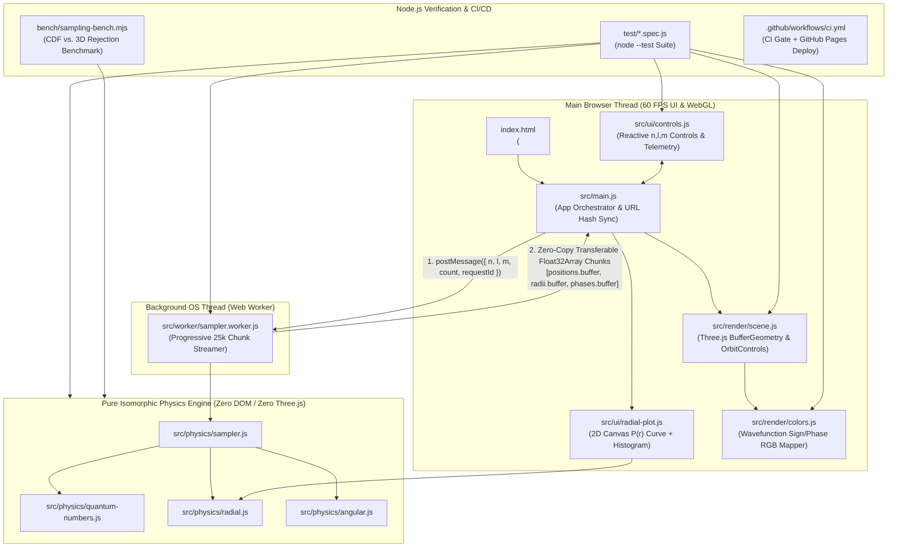

# System Architecture: Zero-Build ES Modules, Web Workers & WebGL GPU Pipeline

> **Navigation:** [README](../README.md) | [Quantum Theory & Visual Guide](./quantum-theory.md) | [Monte Carlo & Inverse-CDF Sampling](./monte-carlo-sampling.md) | [Numerical Methods & IEEE-754](./numerical-methods-js.md) | **System Architecture & WebGL**

This document explains the end-to-end software architecture of **Quantum-Orbital-Renderer**, detailing the responsibilities of every directory, how data streams from the background Web Worker to the GPU at 60 FPS with zero memory copies, and why we use a zero-build vendored ES module setup.

---

## 1. End-to-End Data Flow & Architecture Diagram



---

## 2. Directory & File Responsibilities

| Directory / File | Architectural Role & Why It Is Separated |
| :--- | :--- |
| **[`index.html`](../index.html)** | Single-page HTML5 entry point. Declares the `<script type="importmap">` resolving `'three'`, full-viewport `<canvas id="orbital-canvas">`, and glassmorphic HUD containers (`#controls-panel`, `#info-panel`, `#perf-panel`). |
| **[`src/physics/`](../src/physics/)** | **Pure Mathematical Core** (`quantum-numbers.js`, `radial.js`, `angular.js`, `sampler.js`). Contains **zero** references to `window`, `document`, or `THREE`. Because it is 100% environment-agnostic, the exact same files run inside the browser Web Worker, inside Node.js unit tests (`npm test`), and inside CLI benchmarks (`npm run bench`). |
| **[`src/worker/sampler.worker.js`](../src/worker/sampler.worker.js)** | **Background Thread Streamer.** Runs factorized inverse-CDF sampling off the main UI thread so generating $500,000$ points never freezes camera rotation. Streams progressive chunks (`20k–25k` points per batch) using zero-copy `Transferable` `ArrayBuffer`s. |
| **[`src/render/`](../src/render/)** | **3D WebGL Rendering Layer** (`colors.js`, `scene.js`). Manages the Three.js `Scene`, `PerspectiveCamera`, `OrbitControls`, preallocated `500,000`-point `BufferGeometry`, `THREE.AdditiveBlending`, and $z \le 0$ cross-sectional nodal clipping plane. |
| **[`src/ui/`](../src/ui/)** | **2D HUD & Canvas Layer** (`controls.js`, `radial-plot.js`). Enforces quantum number selection rules ($0 \le l < n$, $|m| \le l$) in the dropdowns, renders live quantum observables, and draws the 2D $P(r)$ curve vs. empirical sample histogram. |
| **[`src/main.js`](../src/main.js)** | **Application Orchestrator.** Connects UI events, URL hash state (`#n=3&l=2&m=0&real=1`), Web Worker messages, 3D scene updates, and the automated multi-scale FPS benchmark. |
| **[`vendor/`](../vendor/)** | **Supplier / Third-Party ES Modules** (`three.module.min.js`, `OrbitControls.js` pinned at `v0.160.0`). Guarantees zero external CDN downtime. |
| **[`test/`](../test/)** | **Automated Verification Suite** (`*.spec.js`). Executed via Node's native `node --test` runner with zero external test framework dependencies. |
| **[`bench/`](../bench/)** | **Performance Benchmarks** (`sampling-bench.mjs`). Compares Factorized Inverse-CDF sampling against naive 3D rejection sampling. |

---

## 3. Non-Blocking Web Worker & Zero-Copy `Transferable` Streaming

### Why a Web Worker Is Essential for 60 FPS
A 60 FPS animation loop (`requestAnimationFrame`) has a strict frame budget of **$\frac{1000\text{ ms}}{60} = 16.67\text{ ms}$**.
Generating $500,000$ 3D quantum points takes $\sim 330\text{ ms}$ of intensive CPU math. If that math ran on the main browser thread, the browser tab would freeze for a third of a second every time the user changed $(n, l, m)$ or dragged a slider.

### How Zero-Copy `Transferable` Buffers Work
Normally, calling `worker.postMessage(data)` copies data using the **Structured Clone Algorithm** (serializing and duplicating megabytes of memory).
Instead, [`src/worker/sampler.worker.js`](../src/worker/sampler.worker.js#L117-L136) passes the underlying `ArrayBuffer` references in the second argument (`transferList`) of `postMessage`:

```javascript
self.postMessage(
  { type: 'chunk', requestId, positions, radii, phases, ... },
  [positions.buffer, radii.buffer, phases.buffer]
);
```

- **OS/Hardware Level Effect:** Instead of copying $25,000 \times 5 \times 4\text{ bytes} = 500\text{ KB}$ per chunk, the browser's C++ engine simply **transfers pointer ownership** of the raw memory pages from the Worker thread to the Main thread in **$O(1)$ time ($\sim 0.01\text{ ms}$)**!

---

## 4. WebGL GPU Pipeline: Preallocated `BufferGeometry`, `AdditiveBlending` & `depthWrite: false`

### Preallocating GPU Memory (`GL_DYNAMIC_DRAW`)
In [`src/render/scene.js`](../src/render/scene.js#L97-L116), we allocate two contiguous `Float32Array(500000 * 3)` buffers (`6 MB` for `(x, y, z)` positions and `6 MB` for `(R, G, B)` vertex colors) **once** at startup and mark them with `THREE.DynamicDrawUsage`.
As each worker chunk arrives, `appendChunk()` copies the slice into the preallocated buffer and expands the active GPU draw range:

```javascript
geometry.setDrawRange(0, activePointCount);
```

This completely eliminates JavaScript Garbage Collection (GC) pauses during streaming and color-mode switches.

### Why `THREE.AdditiveBlending` Requires `depthWrite: false`
In standard opaque 3D rendering, the GPU writes each pixel's distance from the camera into the **Z-buffer (depth buffer)** (`depthWrite: true`) and discards any subsequent fragment drawn behind an existing pixel.
- Because our Monte Carlo points are generated in **random spatial order** (not sorted back-to-front relative to the camera), leaving `depthWrite: true` on semi-transparent points would cause front points to randomly occlude points behind them, creating dark square artifacts when rotating the camera.
- By setting **`blending: THREE.AdditiveBlending`** and **`depthWrite: false`**, overlapping points along any camera ray **commutatively sum their RGB light** ($C_{\text{final}} = \sum_i \alpha C_i$). Brighter glowing regions naturally correspond to higher line-of-sight integrals of $|\psi(r, \theta, \phi)|^2$, while nodal surfaces remain dark!

---

## 5. Why We Vendor Three.js (`vendor/`) & Use `<script type="importmap">`

### The Problem with Bare Module Specifiers in Zero-Build Browser Apps
1. In [`vendor/OrbitControls.js`](../vendor/OrbitControls.js#L1-L12), the official Three.js addon begins with:
   ```javascript
   import { EventDispatcher, Vector3, ... } from 'three';
   ```
2. In Node.js or bundlers (Webpack/Vite), the bare string `'three'` is looked up inside `node_modules/three/`.
3. However, **`node_modules/` is ignored by `.gitignore`** and is **not deployed to GitHub Pages**. Furthermore, native browser ES modules throw a `TypeError` when given a bare specifier like `'three'` unless told where to find the file via a URL path.
4. Relying on an external CDN (`https://unpkg.com/...` or `https://cdn.jsdelivr.net/...`) introduces an external single point of failure: if the CDN is down, slow, or blocked by a corporate firewall, the 3D viewer fails to load.

### How Vendoring + `<script type="importmap">` Solves It
1. **Vendoring (`vendor/`):** We downloaded the exact, immutable ES module release files (`v0.160.0`) directly into [`vendor/`](../vendor/) and committed them to Git:
   ```powershell
   New-Item -ItemType Directory -Force -Path vendor
   Invoke-WebRequest -Uri "https://unpkg.com/three@0.160.0/build/three.module.min.js" -OutFile "vendor/three.module.min.js"
   Invoke-WebRequest -Uri "https://unpkg.com/three@0.160.0/examples/jsm/controls/OrbitControls.js" -OutFile "vendor/OrbitControls.js"
   ```
2. **HTML5 Import Map ([`index.html`](../index.html#L13-L20)):**
   ```html
   <script type="importmap">
     {
       "imports": {
         "three": "./vendor/three.module.min.js",
         "three/addons/": "./vendor/"
       }
     }
   </script>
   ```
   This native browser standard maps `'three'` and `'three/addons/OrbitControls.js'` directly to our local `./vendor/` files with zero build tools!

### Why Local Testing Uses `python -m http.server 8080` (or VS Code Go Live)
Modern browsers enforce strict **Cross-Origin Resource Sharing (CORS)** security rules: scripts loaded with `<script type="module">` and background threads spawned with `new Worker(...)` are blocked on `file:///D:/...` URLs to prevent local filesystem snooping.
Running Python's built-in standard library HTTP server (`python -m http.server 8080`) or VS Code's **Go Live** extension serves the workspace over `http://localhost:8080`, matching the exact HTTPS environment of GitHub Pages.

---

## 6. How the Automated FPS Benchmark Works (`⏱️ Run Automated FPS Benchmark`)

Clicking **`⏱️ Run Automated FPS Benchmark`** in the bottom of the left HUD triggers [`runAutomatedBenchmark()`](../src/main.js#L296-L348):
1. It sequentially steps through four point-cloud scales: **$50,000$**, **$100,000$**, **$250,000$**, and **$500,000$** points.
2. At each scale, it dispatches a full sampling job to `sampler.worker.js` and records the exact wall-clock **Worker Time (`ms`)** until the final transferable chunk arrives.
3. It then samples the live WebGL `requestAnimationFrame` frame rate over a $2.5\text{-second}$ window to compute **Mean FPS**.
4. Finally, it restores the user's previous point count and outputs a formatted Markdown table in `#perf-panel` ready to paste directly into documentation or engineering reports.
